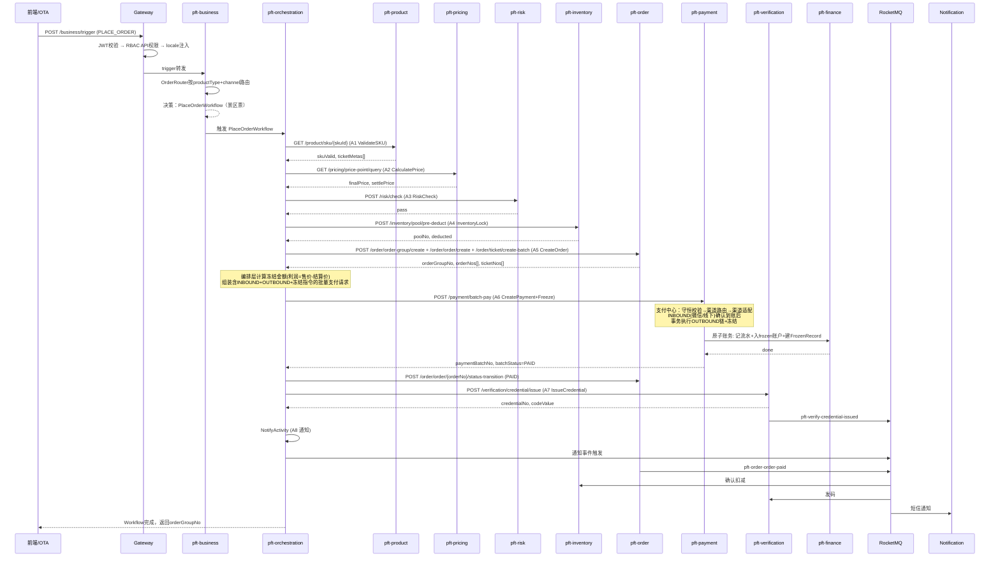
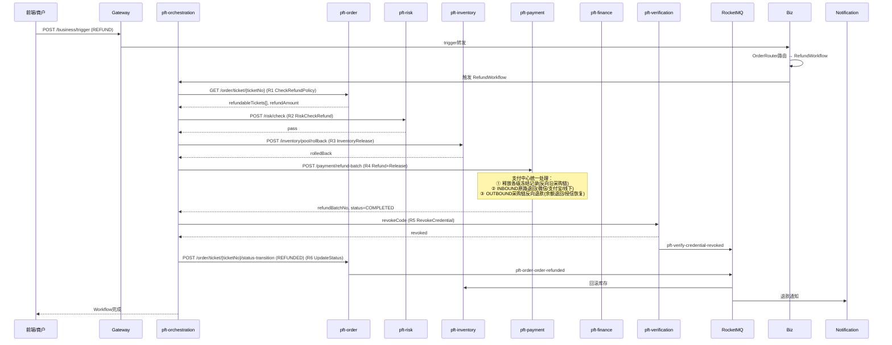
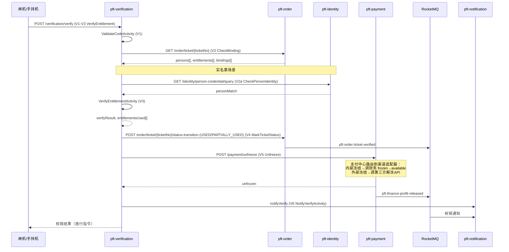

# PFT 2.0 概要设计文档（HLD）

> **HIGH LEVEL DESIGN OVERVIEW**
> 
> 本文档是票付通2.0景区门票SaaS系统的概要设计总览，整合所有架构文档内容，作为一份自包含、可直接评审的标准HLD。

---

## 一、引言与背景

### 1.1 项目概述

**票付通（PFT）2.0** 是面向景区/酒店/演出/游船等旅游行业的SaaS系统，核心角色为供应商、分销商、游客。核心流程：注册→发布商品→分销→购买→出票→核销→退票。

### 1.2 文档引用

| 文档                               | 说明                               | 引用章节             |
| -------------------------------- | -------------------------------- | ---------------- |
| `pft-arch-01-business.md`        | 业务背景与角色流程                        | 引言背景             |
| `pft-arch-02-core-models.md`     | 核心模型、DDL、API清单、状态机               | 数据库设计、接口设计、状态机设计 |
| `pft-arch-02-database.md`        | 完整数据库设计（69张表DDL）                 | 数据库设计            |
| `pft-arch-03-application.md`     | 微服务清单、领域事件、Activity契约、20个服务完整API | 模块设计、接口设计        |
| `pft-arch-04-tech-deployment.md` | 技术选型、部署架构                        | 部署方案             |
| `pft-arch-05-security.md`        | 安全架构                             | 安全设计             |
| `pft-hld-config-spec.md`         | 配置文件规范、Topic清单                   | 配置规范             |

### 1.3 术语约定

> 术语详见 `pft-glossary.md`。核心术语：OrderGroup（聚合单）、Order（子单）、Ticket（票）、Entitlement（权益）、TicketCredential（票凭证）、CustomerCredential（个人凭证）、Customer（C端会员）、TenantStaff（B端员工）、Channel（接入端）、TenantMpConfig（小程序配置）、SKU（票型）、SPU（产品）。

---

## 二、系统概述

### 2.1 系统定位

票付通2.0是**景区门票SaaS平台**，支持多业态（景区/酒店/演出/游船/线路/特产/年卡/餐饮/计时/旅游券等13种），核心差异通过票属性元数据+编排层Adapter承载，核心层业态无关。

### 2.2 核心设计原则

| 原则                       | 说明                                                       |
| ------------------------ | -------------------------------------------------------- |
| 票是一等公民                   | Ticket独立生命周期，独立核销/退款/冻结                                  |
| 属性元数据驱动                  | 新增票属性=新元数据+新规则配置，核心层零改动                                  |
| **业务层定策略，编排层管流程，核心层管原子** | 业务层（pft-business）持有解释权：决定选哪个/组合哪几个编排；编排层按指令组装原子能力，不含业务逻辑 |
| 资金票级冻结                   | FrozenRecord按票维度，核销解冻/退款释放                               |
| RBAC管功能，ABAC管数据          | 功能权限用角色，数据权限用规则引擎                                        |

### 业界多业态架构思想对照（设计指导）

> 本节将PFT方案E与业界三种主流多业态SaaS架构模式对齐，作为所有后续设计的决策参照。完整论证详见 `pft-arch-01-business.md` §2.1 业界多业态架构思想与PFT对照。

**业界共识5条**（阿里/AWS/OTA一致认同，PFT必须遵循）：

1. **核心层代码不变** —— 新业态不改核心域任何代码
2. **业态差异 = 新增配置 + 新增编排** —— 永远不通过核心域代码分支表达差异
3. **配置数据不属于核心模型** —— 业态特化配置在商品域独立存储
4. **运行时状态复用核心池** —— 所有业态复用统一库存/订单/票/资金流
5. **语义翻译在中间层** —— 业态语义通过编排层或metadata JSON翻译为通用模型

**PFT组件对照**：

| PFT组件                          | 业界对应角色                      | 设计指导含义                      |
| ------------------------------ | --------------------------- | --------------------------- |
| `pft-inventory` UNIT/COUNTING池 | 阿里Domain·AWS Pool·OTA统一引擎   | 库存引擎是业态无关核心，池类型区分业态但引擎不变    |
| `metadata` JSON字段              | 阿里SPI插槽·AWS Bridge·OTA配置参数  | 业态语义载体，核心层不解读，编排层负责翻译       |
| `t_seat_map` 等配置表              | 阿里配置态·AWS Silo·OTA商品配置      | 业态特化配置独立存储，不与运行时单据混域        |
| `SeatMapSelectionActivity` 等编排 | 阿里Biz·AWS Bridge+业务·OTA BFF | 新业态=新编排Activity+新配置表，核心层零改动 |

> **PFT定位**：方案E与阿里模式最接近（厚核心薄编排+SPI插槽），融合AWS Pool-Bridge分层思想（metadata作Bridge载体）和OTA统一引擎实践。核心层业态无关是业界共识，不是实验性方案。

---

## 三、总体设计

### 3.1 系统分层架构

```
┌─────────────────────────────────────────────────────────────┐
│  接入层  │           
│         │Gateway 执行：RBAC鉴权、限流、locale注入       │
├─────────────────────────────────────────────────────────────┤
│  业务层  │  pft-business · 解释权（Decision）              │
│          │  编排选择/组合、业务规则配置化、上下文决策      │
├─────────────────────────────────────────────────────────────┤
│  编排层  │  引擎（pft-orchestration的app/目录）   │
│          │  通用Workflow + 业态Adapter + 套票组合编排     │
│          │  按业务层指令执行，不含业务解释逻辑             │
├─────────────────────────────────────────────────────────────┤
│  核心层  │  20个业务微服务，各域只暴露原子能力           │
│          │  Product/Pricing/Inventory/Order/Payment/...    │
└─────────────────────────────────────────────────────────────┘
```

### 3.2 20个微服务全景

| #   | 服务                | 归属域  | 核心职责                              | 阶段  | 数据库                           |
| --- | ----------------- | ---- | --------------------------------- | --- | ----------------------------- |
| 01  | pft-product       | 商品   | SKU管理、票属性元数据、套票编排定义               | MVP | pft-product                   |
| 02  | pft-pricing       | 商品   | 价格体系（L0/L1/L2）、价格查询、价格快照          | MVP | pft-pricing                   |
| 03  | pft-inventory     | 商品   | 库存池（COUNTING/UNIT）、配额、Redis预扣     | MVP | pft-inventory                 |
| 04  | pft-order         | 交易   | OrderGroup→Order→Ticket三级聚合、状态机   | MVP | pft-order                     |
| 05  | pft-business      | 业务决策 | 解释权：编排选择/组合、业务规则配置化、上下文决策（路由到编排层） | MVP | pft-business                  |
| 06  | pft-orchestration | 交易   | 编排引擎（下单/退款/核销/分销Workflow），纯原子能力组装 | MVP | pft-orchestration（Workflow历史） |
| 07  | pft-payment       | 支付   | 支付渠道适配、冻结指令随支付下发、批量支付（分销采购链）、退款+释放、解冻   | MVP | pft-payment                   |
| 08  | pft-verification  | 核销   | 核销点管理、在线/离线核销、码池管理                | MVP | pft-verification              |
| 09  | pft-finance       | 财务   | 统一账户、票级冻结/解冻（账本执行）、资金流水、提现、发票           | P2  | pft-finance                   |
| 10  | pft-risk          | 风控   | 黑名单校验、风控规则引擎、账号封禁                 | P2  | pft-risk                      |
| 11  | pft-device        | 设备   | 设备注册、分组、状态管理、绑定核销点                | P2  | pft-device                    |
| 12  | pft-distribution  | 分销   | 4级采购链、共享库存池、分销双模式                 | P3  | pft-distribution              |
| 13  | pft-identity      | 用户商户 | 统一身份、RBAC+ABAC权限、Keycloak接入       | MVP | pft-identity                  |
| 14  | pft-platform      | 平台运营 | 平台字典、套餐管理、审批流、投诉工单                | MVP | pft-platform                  |
| 15  | pft-notification  | 通知   | 短信/模板消息/邮件/Webhook                | P2  | pft-notification              |
| 16  | pft-audit         | 审计   | 审计日志采集/存储/查询、CDC输出                | P2  | pft-audit                     |
| 17  | pft-application   | 应用   | 应用市场、套餐-应用绑定                      | P3  | pft-platform（共用）              |
| 18  | pft-marketing     | 营销   | 优惠券、活动、玩法编排                       | P3  | pft-marketing                 |
| 19  | pft-data-pipeline | 数据   | CDC→ES/OLAP、搜索同步、实时报表             | P2  | pft-data-pipeline             |
| 20  | pft-open-platform | 开放   | OpenAPI、签名鉴权、流控                   | P3  | pft-open-platform             |

> 详细微服务清单、领域映射、服务边界见 `pft-arch-03-application.md` §4.1。

### 3.3 服务间通信模式

| 模式      | 实现                    | 适用场景                |
| ------- | --------------------- | ------------------- |
| 同步RPC   | OpenFeign (HTTP/REST) | 强一致读写：扣库存、查价格、下单    |
| 异步消息    | RocketMQ 5.x (事务消息)   | 状态扩散：订单已支付、票已核销     |
| 编排工作流   | Workflow引擎            | 跨服务长流程：下单→锁库存→支付→出票 |
| 事件订阅    | RocketMQ广播            | 领域事件外溢：CDC→数据管道     |
| OpenAPI | HTTP/JSON + HMAC签名    | 外部商户/分销商集成          |

> 详细通信模式、领域事件清单见 `pft-arch-03-application.md` §4.2~§4.4。

---

## 四、模块设计

> 20 个微服务的职责与对外接口详见 `pft-arch-02-core-models.md` §2（9 个核心服务 **60 个接口**）+ `pft-arch-03-application.md` §4.5（11 个补充服务 **97 个接口**），合计 **157 个 REST API**。

### 4.1 各微服务职责速查

| 服务                | 不负责           | 边界说明                              |
| ----------------- | ------------- | --------------------------------- |
| pft-product       | 不管分销结算价       | 商品管结构，价格管金额                       |
| pft-pricing       | 不管成本价         | 售价体系独立                            |
| pft-business      | 不含原子能力调用      | 业务层只做编排选择/组合，不碰原子API拼接            |
| pft-orchestration | 不含业务逻辑，不含编排路由 | 编排层不关心"为什么选我"，路由已上移到 pft-business |
| pft-finance       | 不含支付渠道对接，不含业务编排逻辑 | 账户与支付分离；财务是纯账本执行者（被支付中心调），守恒校验/依赖顺序在支付中心 |
| pft-risk          | 不含审计日志存储      | 风控消费审计日志                          |
| pft-device        | 不含核销逻辑        | 设备管理只管注册/分组/状态                    |

---

## 五、数据库设计

> 完整DDL见 `pft-arch-02-database.md`。**69张表**覆盖18个一级领域。用户/接入域结构：Customer 系列（4张广播表）+ TenantStaff（分片）+ Channel + TenantMpConfig + RBAC 系列（5张分片）+ Org（分片）+ Tenant（广播）。

### 5.1 表统计

| 类别          | 表数     | 说明                                                                                                                      |
| ----------- | ------ | ----------------------------------------------------------------------------------------------------------------------- |
| 核心表（§3.7已有） | 16     | 订单/票/凭证/权益/价格/库存/账户/冻结                                                                                                  |
| 用户身份域（重构后）  | 11     | Customer 4张(广播)/TenantStaff/Org/RBAC 5表(分片)/Tenant+Config（Channel-First 接入端已迁至平台运营域）                                    |
| 辅助表（其他）     | 39     | 退款单/码池/核销点/资金流水/提现/银行卡/发票/资源批次/SPU/SKU/票属性/售卖规则/套票定义/供应商商品/风控4表/Tenant/设备2表/分销2表/平台运营10表/通知2表/审计日志/应用2表/优惠券/CDC同步/API密钥 |
| **合计**      | **69** | 分17个独立数据库                                                                                                               |

### 5.2 分库策略

- 分库维度：tenant_id（B端）；C端与 Channel-级表走 ShardingSphere 广播表
- ShardingSphere按tenant_id取模分库（MVP: 4库）
- 全局广播表（C端+平台级+接入级）：t_customer / t_customer_identity / t_customer_credential / t_tenant / t_channel / t_tenant_mp_config（接入端表归属平台运营域）/ t_sys_dict / t_approval_flow（PLATFORM scope）/ t_ticket_meta（t_access_endpoint 已废弃并入 t_channel）
- MVP阶段可合库（单实例多schema），Phase 2按租户量拆物理实例

### 5.3 用户体系与接入模型

> 本节聚焦用户/接入两大主题的架构选型，详细 DDL 见 `pft-arch-02-database.md` §2.9 + §2.12。**注意：t_channel/t_tenant_mp_config/t_channel_tenant_binding 已从用户域(pft-identity)迁至平台运营域(pft-platform)。**

#### 5.3.1 四象限角色定义

| 维度   | Customer（C端）                                               | TenantStaff（B端）                                     | Tenant（租户主体）                                               | Channel（接入端）                       |
| ---- | ---------------------------------------------------------- | --------------------------------------------------- | ---------------------------------------------------------- | ---------------------------------- |
| 表    | `t_customer` + `t_identity` + `t_binding` + `t_credential` | `t_tenant_staff`（+ t_org 部门 + t_tenant_position 岗位） | `t_tenant`（无 is_platform 字段，平台租户约定 `tenant_no='PLATFORM'`） | `t_channel` + `t_tenant_mp_config` |
| 分片   | 广播表                                                        | 非分片单表（180~300万单表足够）                                 | 广播表                                                        | 广播表                                |
| 主键语义 | customer_id                                                | staff_id（tenant 内）                                  | tenant_id                                                  | channel_id / mp_config_id          |
| 状态字段 | customer_status                                            | staff_status                                        | tenant_status                                              | channel_status / config_status     |
| 注册触发 | **首次登录**                                                   | 管理员创建                                               | 平台或商户申请                                                    | 预置 + 按需建                           |

#### 5.3.2 C 端 / B 端 严格分离

```
Customer(主账号) ──────────────────────────────────────────────┐
├── 强识别字段（NULL）：wechatUnionid/alipayUserId/phone/idNumber    │
├── identities[](1:N)：多渠道 openid/OTA uid，独立建表                │
├── tenantBindings[](1:N)：在每个租户下唯一一条                       │
└── credentials[](1:N)：人脸/身份证，跨订单复用                       │
                                                                  │
TenantStaff(员工账号) ──────────────────────────────────────────┘
├── 平台员工 = tenant_type=INTERNAL 租户下的员工
├── 租户员工 = 业务租户下的员工（主账号=RBAC OWNER角色，不再用is_owner字段）
├── 登录凭证 → t_staff_credential（PASSWORD/MFA_TOTP/企微扫码等，password_hash已移出staff表）
├── 安全配置 → t_staff_config（mfa_enabled/login_2fa_confirm等KV配置，mfa_enabled已移出staff表）
└── MFA：平台租户员工默认强制，租户员工可配（配于t_staff_config）
```

**关键设计点**：

- C端与B端表彻底分离，代码路径独立
- 平台 = PLATFORM 租户（约定 `tenant_no='PLATFORM'`），不在类型上做分裂（self-tenant 模式）
- 平台超管 = PLATFORM 租户下的 t_tenant_staff（与租户员工同代码路径）+ RBAC SUPER_ADMIN 角色（双因子）

#### 5.3.3 Person 延迟建 Customer

```
下单 / 代下单 / 现场核销 → 不主动为 person 建 Customer
    Person.globalCustomerId = 0
    ↓
用户首次登录（tenantContext=当前租户）→
    微信openid 登录：查 t_customer_identity(identity_type, identity_value) 唯一命中 → customer_id
                     未命中 → 若带 unionid，按 uk_wechat_unionid_tenant 收敛复用并挂载新 identity；否则新建 customer
    手机号登录：查 t_customer WHERE phone=P AND register_tenant_id=tenantContext → 0..N
                ├ 0 → 新建纯手机号 customer
                ├ 1 → 直接登入
                └ N → 弹身份选择器，用户选一个登入（每次登录都选）
    ↓
后台批处理 / 客户端按手机号回填 Person.global_customer_id（phone 非唯一时按订单上下文取最匹配或留人工）
```

> **租户隔离（方案Y）**：`wechat_unionid`/`alipay_user_id`/`id_number` 唯一键带 register_tenant_id，仅本租户内收敛；`phone` 非唯一、可多账号共用。不同租户即使同 unionid/同手机号也各建独立 customer，互不识别。跨租户游客分析以票务 persons[] / Person.globalCustomerId 为锚点，不依赖 buyer customer 合并。
> **不合并原则**：多账号共存靠"登录身份选择器 + 注销/解绑收敛"，永不自动或验证后合并；绑手机遇已占用允许共存（不拒绝），仅提示用户可注销其一或解绑以简化；禁止解绑账号最后一个凭证；注销=停用保留。罕见需保留双方历史的场景转人工。
> **平台账号中心（可选叠加）**：仅当用户在 MP_PLATFORM 账号中心主动授权时，才将多租户 customer 关联为同一人；不自动按 phone 硬收敛，避免游客产生"信息从哪儿来"的隐私疑虑。

**业界动机**：代下单/现场购买场景下，下单人 ≠ 取票人 ≠ 实际游玩人，所以不强行建 Customer；用户的"首次登录"才是他作为本人出现的标志。

#### 5.3.4 Channel-First 统一接入

| 概念         | 定义                                                                |
| ---------- | ----------------------------------------------------------------- |
| 端（Channel） | 服务商级"对接口"，所有流量入口（MP/PC/API/OFFLINE）= 一条 `t_channel` 记录            |
| scope      | `PLATFORM`（服务商级预置5端）/ `TENANT`（按需API端）                            |
| 对外端标识       | `app_id VARCHAR(32)`：订单组创建来源端（指向 t_channel.app_id；下单时由 X-App-Id 请求头自动注入，编排层换取 channelId，前端零传参）   |
| 子标识        | `app_ref VARCHAR(64)`：小程序=mp_config_id；API=子渠道号                  |
| 凭证归属       | 小程序 appId 归 `t_tenant_mp_config`（租户资产）；API Key 归 `t_channel`（端资产） |

**预置5端**：

| code             | type    | scope    | 说明                  |
| ---------------- | ------- | -------- | ------------------- |
| MP_TENANT_HOSTED | MP      | PLATFORM | 租户托管小程序（承载N租户appId） |
| MP_PLATFORM      | MP      | PLATFORM | 平台C端小程序             |
| PC_TENANT        | PC      | PLATFORM | 租户B端后台（所有租户共用登录）    |
| PC_PLATFORM      | PC      | PLATFORM | 平台超管后台              |
| OFFLINE          | OFFLINE | PLATFORM | 线下窗口                |

**请求 → 租户上下文映射**：

```
微信小程序请求（带 appId）
    ├─ 通过 t_tenant_mp_config(unionid by appId) → tenant_id
    └─ 会话上下文：channel_id=MP_TENANT_HOSTED, tenant_context_id=tenant_id

美团 API 请求（带 appKey+签名）
    ├─ 通过 t_channel(appKey) → channel_id + owner_tenant_id
    ├─ staffCode 优先 / 否则 default_operator_staff_id 兜底
    └─ 会话上下文：channel_id, tenant_context_id=owner_tenant_id

PC_TENANT 登录
    ├─ 员工输入租户编码+手机+密码 → t_tenant_staff
    └─ 会话上下文：channel_id=PC_TENANT, tenant_context_id=staff.tenant_id
```

#### 5.3.5 订单参与者（多态字段组）

```
t_order_group 参与者：
├── seller_tenant_id        卖家租户（商品归属）
├── channel_id              入口端（Channel-First）
├── app_id                  对接端标识（指向 t_channel.app_id，创建来源端）
├── app_ref                 对接端自定义子标识
├── operator_type           CUSTOMER / TENANT_STAFF
├── operator_id             多态
├── operator_tenant_id      操作人所属租户（=会话 tenant_context_id）
├── buyer_type              CUSTOMER / ANONYMOUS（不引入TENANT）
├── buyer_id                多态
└── buyer_customer_id       C端筛选冗余（带索引报表用）
```

**5个典型场景**：

| 场景          | channel_id       | app_id         | app_ref        | operator                            | buyer                           |
| ----------- | ---------------- | -------------- | ----------------------------------- | ------------------------------- |
| 租户A的MP游客自购  | MP_TENANT_HOSTED | (空串，appId归属t_tenant_mp_config) | A_mp_config_id | CUSTOMER:cust1                      | CUSTOMER:cust1                  |
| 分销商B员工PC代下A | PC_TENANT        | (空串)         | null           | TENANT_STAFF:B_staff, opTenant=B    | CUSTOMER:B.default_customer_id  |
| 美团API下A     | API_MEITUAN      | 美团app_id      | null/子号        | TENANT_STAFF:美团default, opTenant=美团 | CUSTOMER:美团.default_customer_id |
| 平台MP用户下A    | MP_PLATFORM      | (空串)         | null           | CUSTOMER:cust1                      | CUSTOMER:cust1                  |
| 租户A窗口售A     | OFFLINE          | (空串)         | null           | TENANT_STAFF:A_staff, opTenant=A    | ANONYMOUS                       |

#### 5.3.6 注销合规

| 账号类型            | 注销策略                                                 | 备注                       |
| --------------- | ---------------------------------------------------- | ------------------------ |
| Customer（C端）    | 主动注销：30天冷静期 → `customer_status=CANCELLED`；保留订单记录以备审计 | 不能立刻硬删，受订单、票、退款、行程单据追溯约束 |
| TenantStaff（B端） | 离职注销：保留工号关联，无登录能力；离职关系保留于审计域                         | 不能直接删，受流程/票据追溯约束         |
| Tenant          | 租户级注销：先冻结（status=INACTIVE）→ 90天数据保留期 → 物理迁移走归档       | 与 GDPR / 个保法对齐           |

---

## 六、接口设计

> 20 个微服务完整 API 清单见：
> 
> - 9 个核心服务 **60 个接口**：`pft-arch-02-core-models.md` §2
> - 11 个补充服务 **97 个接口**：`pft-arch-03-application.md` §4.5
> - 合计 **157 个 REST API**

### 6.1 接口设计原则

| 原则       | 说明                                                     |
| -------- | ------------------------------------------------------ |
| 路径参数用业务号 | orderGroupNo/orderNo/ticketNo（uk唯一索引），内部查id再操作         |
| 幂等保障     | request_id + 重试退避（同步）；dedup表（异步）                       |
| 统一错误码    | 7位数字：`{3位服务编号}{4位错误类型}`，通用码000开头，内部和对外统一返回原始数字码，详见§6.2 |
| 认证方式     | Gateway统一JWT校验→RBAC API权限→转发（内部服务）；HMAC签名（开放平台）        |

### 6.2 错误码设计

#### 6.2.1 编码规则

> 7位数字格式：`{3位服务编号}{4位错误类型}`

| 段    | 位数  | 说明                                  | 示例        |
| ---- | --- | ----------------------------------- | --------- |
| 服务编号 | 3位  | 每个微服务独占一个编号（001~999），编号前缀天然隔离各系统错误码 | 010=订单域   |
| 错误类型 | 4位  | 每个服务独占10000个错误码空间（0000~9999），内部自行分配 | 0006=状态冲突 |

**为什么是7位而非5位**：

- 服务数量已达20个，2位编号只支持99个服务，3位编号支持999个服务，预留充足扩展空间
- 每服务10000个错误码空间（4位），远超实际需求（每服务约10~30个），但避免了3位（999个）类型空间被突破的风险
- 7位格式在代码中可直接用INT类型存储和传输，无需字符串包装

**冲突隔离机制**：

- **服务编号前缀隔离**：不同服务的编号不同（如010≠030），即使错误类型码相同（如010-0004≠030-0004），错误码也不会冲突
- **Gateway统一管理通用码**：000开头的7位码（0000001~0009999）为通用错误码，不分配给任何业务服务，由Gateway直接返回
- **编排层下游透传**：pft-orchestration调用下游服务返回错误时，直接透传原服务7位错误码，不做任何包装或映射

#### 6.2.2 20个服务编号范围分配

**核心服务（10个）**：

| 服务                | 编号  | 错误码范围           | 示例                                                        |
| ----------------- | --- | --------------- | --------------------------------------------------------- |
| 网关                | 000 |                 |                                                           |
| pft-product       | 001 | 0010000~0019999 | 0010004=SKUNotFound, 0010005=SKUAlreadyExists             |
| pft-pricing       | 002 | 0020000~0029999 | 0020004=PricePointNotFound, 0020006=PriceConflict         |
| pft-inventory     | 003 | 0030000~0039999 | 0030004=PoolNotFound, 0030006=InsufficientStock           |
| pft-order         | 010 | 0100000~0109999 | 0100004=OrderNotFound, 0100006=OrderStateConflict         |
| pft-orchestration | 050 | 0500000~0509999 | 0500001=WorkflowNotFound, 0500006=WorkflowStateConflict   |
| pft-payment       | 030 | 0300000~0309999 | 0300004=PaymentNotFound, 0300006=PaymentStateConflict     |
| pft-verification  | 040 | 0400000~0409999 | 0400004=CredentialNotFound, 0400006=CredentialAlreadyUsed |
| pft-finance       | 020 | 0200000~0209999 | 0200004=AccountNotFound, 0200006=InsufficientBalance      |
| pft-risk          | 070 | 0700000~0709999 | 0700004=RuleNotFound, 0700005=Blacklisted                 |

**补充服务（10个）**：

| 服务                | 编号  | 错误码范围           | 示例                                                  |
| ----------------- | --- | --------------- | --------------------------------------------------- |
| pft-identity      | 060 | 0600000~0609999 | 0600004=UserNotFound, 0600006=CredentialConflict    |
| pft-device        | 080 | 0800000~0809999 | 0800004=DeviceNotFound, 0800006=DeviceStateConflict |
| pft-business      | 051 | 0510000~0519999 | 0510001=RouteNotFound, 0510006=DecisionRuleConflict |
| pft-distribution  | 090 | 0900000~0909999 | 0900004=RelationNotFound, 0900006=ChainTooDeep      |
| pft-platform      | 011 | 0110000~0119999 | 0110004=DictNotFound, 0110005=DictAlreadyExists     |
| pft-notification  | 012 | 0120000~0129999 | 0120004=TemplateNotFound, 0120006=SendFailed        |
| pft-audit         | 013 | 0130000~0139999 | 0130004=LogNotFound                                 |
| pft-application   | 014 | 0140000~0149999 | 0140004=AppNotFound, 0140005=AppAlreadyExists       |
| pft-marketing     | 015 | 0150000~0159999 | 0150004=CouponNotFound, 0150006=CouponStockOut      |
| pft-data-pipeline | 016 | 0160000~0169999 | 0160004=SyncTaskNotFound, 0160006=TaskStateConflict |
| pft-open-platform | 017 | 0170000~0179999 | 0170004=ApiKeyNotFound, 0170006=PushFailed          |

#### 6.2.3 通用错误码（所有服务共享，000开头）

| 错误码     | 说明               | 返回方     |
| ------- | ---------------- | ------- |
|         |                  |         |
| 0000002 | 未认证（未登录/Token无效） | Gateway |
| 0000003 | 无权限（RBAC拦截）      | Gateway |
|         |                  |         |
|         |                  |         |
|         |                  |         |
|         |                  |         |
| 0000008 | 限流（Gateway流控拦截）  | Gateway |

> Gateway拦截的错误码（0000001/0000002/0000003/0000008）由Gateway直接返回，不转发到业务服务。业务服务错误码（0000004~0000007）由各服务自行返回。

#### 6.2.4 统一错误响应格式

> 内部传递和对外输出统一使用7位INT数字码，不做任何字符串包装。各服务返回原始码，服务间调用透传原码，Gateway不重包装。

```json
{
  "code": 0001000,              // 7位INT数字码，直接透传
  "message": "订单状态冲突",    // 系统内部按locale已转换（详见§6.3国际化）
  "detail": "Order[OG20260701001] status=PAID, expected UNPAID",
  "timestamp": "2026-07-01T15:30:00.888+08:00",
  "traceId": "trace-a1b2c3d4"
}
```

**编排层透传规则**：pft-orchestration调用下游服务返回错误码时，直接透传原服务7位码。例如pft-order返回 `0100006` → 编排层直接返回 `0100006`，不做任何包装或映射。

### 6.3 国际化设计

> PFT作为多租户SaaS平台，需支持多语言、多币种、多时区。国际化贯穿从接入层到核心层的完整链路。

#### 6.3.1 国际化覆盖范围

| 覆盖维度       | 说明                       | 实现方式                       |
| ---------- | ------------------------ | -------------------------- |
| 错误码message | 各服务根据请求locale返回对应语言的错误描述 | i18n资源文件 + LocaleContext   |
| 商品名称/描述    | SPU/SKU名称、票属性描述等多语言      | 通用翻译表 `t_i18n_translation` |
| 平台字典       | 字典项名称多语言                 | 通用翻译表 `t_i18n_translation` |
| 通知模板       | 短信/模板消息/邮件内容多语言          | 通用翻译表 `t_i18n_translation` |
| 前端UI       | 菜单/按钮/提示文案多语言            | 前端i18n框架（按locale加载翻译包）     |

#### 6.3.2 支持语言

| 阶段  | 语言代码    | 语言     | 说明              |
| --- | ------- | ------ | --------------- |
| MVP | `zh-CN` | 中文（默认） | 默认语言，无需翻译表      |
| MVP | `en-US` | 英文     | 必须支持，海外景区/OTA场景 |
| P2  | `ja-JP` | 日文     | 日本游客常见          |
| P2  | `ko-KR` | 韩文     | 韩国游客常见          |
| P3  | 其他      | 按需添加   | 翻译表方案零改动扩展      |

#### 6.3.3 locale传递链路

```
前端/OTA请求 → Gateway解析locale → 注入LocaleContext ThreadLocal
    → 转发到编排层/核心层（OpenFeign拦截器自动传递X-PFT-Locale header）
    → 各服务从LocaleContext读取locale → 选择对应i18n资源/翻译表记录
```

**请求头约定**：

| Header           | 说明   | 示例           | 默认值             |
| ---------------- | ---- | ------------ | --------------- |
| `X-PFT-Locale`   | 语言代码 | `en-US`      | `zh-CN`         |
| `X-PFT-TimeZone` | 时区ID | `Asia/Tokyo` | `Asia/Shanghai` |
| `X-PFT-Currency` | 币种代码 | `JPY`        | `CNY`           |

> Gateway解析这三个Header注入LocaleContext，内部服务间RPC通过OpenFeign拦截器自动传递。缺失Header时使用默认值。

#### 6.3.4 错误码message国际化

各服务维护 `resources/i18n/errors_{locale}.properties` 资源文件，格式：

```properties
# errors_zh_CN.properties（中文默认）
0100006=订单状态冲突
0100004=订单不存在

# errors_en_US.properties（英文）
0100006=Order state conflict
0100004=Order not found
```

**运行时选择逻辑**：

- 服务内部根据 `LocaleContext.getLocale()` 选择对应locale的资源文件
- locale对应的资源文件不存在时，回退到 `zh-CN`（中文默认）
- 前端无需额外翻译错误码，服务已返回对应语言的message

#### 6.3.5 业务字段多语言存储方案

**方案：通用翻译表 `t_i18n_translation`**（独立表，而非JSON字段）

理由：

- JSON字段方案需在源表加i18n JSON字段，查询需JSON_EXTRACT，性能差
- 独立翻译表方案：一张通用表管理所有多语言字段，查询简单，新增语言只需加翻译记录，不需改表结构
- 翻译表归入 pft-platform 库，作为广播表（所有租户共享语言定义）

```sql
CREATE TABLE t_i18n_translation (
    id              BIGINT      NOT NULL AUTO_INCREMENT COMMENT '主键ID',
    table_name      VARCHAR(32) NOT NULL COMMENT '源表名（如t_spu/t_sku/t_sys_dict）',
    entity_id       BIGINT      NOT NULL COMMENT '源表实体ID',
    field_name      VARCHAR(32) NOT NULL COMMENT '源表字段名（如spu_name/description）',
    locale          VARCHAR(8)  NOT NULL COMMENT '语言代码（zh-CN/en-US/ja-JP等）',
    field_value     TEXT        NOT NULL COMMENT '翻译值',
    create_time     DATETIME    NOT NULL DEFAULT CURRENT_TIMESTAMP COMMENT '创建时间',
    update_time     DATETIME    NOT NULL DEFAULT CURRENT_TIMESTAMP ON UPDATE CURRENT_TIMESTAMP COMMENT '更新时间',
    create_by       VARCHAR(64) NOT NULL DEFAULT 'system' COMMENT '创建人',
    update_by       VARCHAR(64) NOT NULL DEFAULT 'system' COMMENT '更新人',
    deleted         TINYINT     NOT NULL DEFAULT 0 COMMENT '删除标记',
    PRIMARY KEY (id),
    UNIQUE KEY uk_translation (table_name, entity_id, field_name, locale),
    KEY idx_entity (table_name, entity_id),
    KEY idx_locale (locale)
) COMMENT='国际化翻译表：通用多语言字段存储';
```

**查询方式**：

- 默认语言（zh-CN）：直接查源表字段（如 `t_spu.spu_name`），无需查翻译表
- 其他语言：查翻译表 `t_i18n_translation WHERE table_name='t_spu' AND entity_id=? AND field_name='spu_name' AND locale='en-US'`
- 翻译表不存在对应locale记录时，回退到源表默认字段值

**需要多语言支持的核心字段**：

| 源表                | 字段                                    | 说明                                    |
| ----------------- | ------------------------------------- | ------------------------------------- |
| t_spu             | spu_name, description                 | 产品名称/描述                               |
| t_sku             | sku_name, description                 | SKU名称/描述（如"成人票"→"Adult Ticket"）       |
| t_ticket_meta     | attribute_name, attribute_description | 票属性名称/描述                              |
| t_sys_dict        | dict_name                             | 字典项名称（dict_name_en字段后续迁移到翻译表）         |
| t_notify_template | template_content                      | 通知模板内容（template_content_en字段后续迁移到翻译表） |
| t_verify_point    | point_name                            | 核销点名称                                 |

#### 6.3.6 平台国际化管理

pft-platform提供国际化管理API，详见 `pft-arch-03-application.md` §4.5.4 PL19~PL24：

| #    | 方法   | 路径                                  | 说明      |
| ---- | ---- | ----------------------------------- | ------- |
| PL19 | GET  | `/platform/i18n/language/list`      | 查支持语言列表 |
| PL20 | GET  | `/platform/i18n/currency/list`      | 查支持币种列表 |
| PL21 | POST | `/platform/i18n/translation/create` | 创建翻译记录  |
| PL22 | GET  | `/platform/i18n/translation/query`  | 查翻译记录   |
| PL23 | PUT  | `/platform/i18n/translation/{id}`   | 更新翻译记录  |
| PL24 | POST | `/platform/i18n/translation/batch`  | 批量导入翻译  |

> 翻译表DDL见 `pft-arch-02-database.md` §9（平台运营域）。

### 6.3.7 币种处理（Currency）

> MVP阶段只展示不转换。多商户多币种 / 实时汇率 / 跨境结算等场景均为 P3 预留。

| 维度            | MVP规则                                                                           | 未来预留                |
| ------------- | ------------------------------------------------------------------------------- | ------------------- |
| 金额存储          | `BIGINT` 分，币种 = 该租户配置的 `t_tenant.currency`                                      | 字段 `currency` 全链路保留 |
| 金额传输          | API 返回 `amount` + `currency`；金额相关字段（order/ticket/refund/payment/fund_flow 等）必须带 | 结构不变                |
| 金额展示          | `CurrencyRenderUtil` 按 `locale` 本地化：符号/千分位/小数位（小币种如JPY=0 位，CNY=2 位）             | P3 引入实时汇率转换         |
| 多币种订单         | **不支持**：同一订单（OrderGroup）下所有 Order.currency 一致 = seller_tenant.currency          | P3 支持跨境             |
| 汇率转换          | **不做**：t_i18n_currency.exchange_rate_to_cny 字段保留但不参与运行                          | P3 实时汇率接入           |
| 结算币种          | 商户币种 = t_tenant.currency                                                        | P3 跨境结算             |
| API 必带 header | `X-PFT-Currency` 由 Gateway 根据租户上下文注入，前端只传金额                                     | 同                   |

**MVP 实施要点**：

1. **存储**：金额字段全部 `BIGINT` 分（已有规范）；新增 `currency VARCHAR(8) DEFAULT 'CNY'` 字段已落在 `t_order_group` / `t_payment_record` / `t_tenant` 等表。
2. **校验**：OrderGroup 创建时 `currency` = seller_tenant.currency；不同币种卖家的子单不可合并到同一聚合单（v2 已不支持购物车跨商户）。
3. **展示**：前端使用 `CurrencyRenderUtil.format(amount, currency, locale)`，禁止前端硬编码 `¥` 等符号。
4. **不引入汇率字段**：所有计算保持币种一致，多币种换算留 P3。

**P3 升级路径**：

- 引入 `t_real_time_exchange_rate` 表 + 定时拉取第三方汇率
- OrderGroup 拆为多币种 carrier；聚合层加汇率快照表
- 结算多币种分账规则

---

## 七、关键流程设计（含时序图）

### 7.1 PlaceOrderWorkflow · 标准下单时序图

> **支付+冻结原子化**：冻结随支付请求下发，支付确认到账瞬间由支付中心调财务完成"入账+冻结"原子操作。编排层不再二次触发冻结（去掉了原 A8 FreezeProfit 步骤）。分销采购链的批量扣转也统一走支付中心入口。



> **关键变化**：
> - 原 A6 CreatePayment + A8 FreezeProfit 合并为 A6 CreatePayment+Freeze（支付含冻结，原子完成）
> - 支付中心是所有资金动作的统一入口（INBOUND收款 + OUTBOUND采购扣转 + 冻结）
> - 编排层只管业务编排（出票/发码/通知），完全不碰财务
> - MQ 消费方不再含"冻结"动作（冻结已在支付阶段完成）

### 7.2 RefundWorkflow · 退款时序图



> **关键变化**：
> - 原 R4 PaymentRefund + R5 FinanceRelease 合并为 R4 Refund+Release（支付中心统一处理退款+释放冻结）
> - 退款时支付中心反向沿采购链逐级释放冻结 + 退款
> - 编排层不再直接调财务，所有资金动作走支付中心

### 7.3 VerifyWorkflow · 核销时序图

> **解冻走支付中心**：核销解冻时编排层调支付中心，支付中心路由到渠道适配器（内部冻结→调财务解冻；外部冻结→调第三方解冻API）。



> **编排层Activity详细契约**（入参/出参/幂等键/失败策略）见 `pft-arch-03-application.md` §4.4.2（PlaceOrderWorkflow/RefundWorkflow/VerifyWorkflow/CompositeTicketWorkflow）。

---

## 八、状态机设计

> 完整状态机定义见 `pft-arch-02-core-models.md` §3.7.3。本节补充每个状态转移的**超时策略**和**关联RocketMQ Topic**。

### 8.1 OrderGroup 状态机 · 补充

| 变迁       | 前置→后置                          | 超时策略                                                                                                                                                                                                              | 关联Topic                     | 上下游联动                                     |
| -------- | ------------------------------ | ----------------------------------------------------------------------------------------------------------------------------------------------------------------------------------------------------------------- | --------------------------- | ----------------------------------------- |
| 组合支付部分成功 | UNPAID→PARTIAL_PAID            | 组合支付场景下多条PaymentRecord逐一回调，任意一条PAID即整体进入PARTIAL_PAID                                                                                                                                                              | 无独立Topic                    | 已PAID的PaymentRecord对应的子单→PAID；已PAID渠道资金确认 |
| 支付全部成功   | UNPAID/PARTIAL_PAID→PAID       | 所有PaymentRecord均已PAID，totalAmount=各PR金额之和                                                                                                                                                                         | `pft-order-order-paid`      | 各子单→PAID；库存确认扣减；核销发码                 |
| 全部退款     | PAID/PARTIAL_REFUNDED→REFUNDED | 退款审核48h超时→自动通过                                                                                                                                                                                                    | `pft-order-order-refunded`  | 各子单→REFUNDED；库存回滚；凭证撤销               |
| 部分退款     | PAID→PARTIAL_REFUNDED          | 无超时                                                                                                                                                                                                               | 无独立Topic                    | 仅影响被退子单                                   |
| 超时取消     | UNPAID→CANCELLED               | **SKU票属性驱动**：编排层下单时从各SKU.ticketMetas读取`PAY_TIMEOUT`属性（单位秒），取聚合单内**最短超时值**写入order_group.pay_timeout_at（DATETIME(3)秒级精度），Temporal Workflow通过Schedule to close设置定时器。不同SKU可配置不同超时（如演出票10min、景区票30min、酒店60min），非全局固定参数 | `pft-order-order-cancelled` | 各子单→CANCELLED；库存回滚预扣                      |

### 8.2 Order 状态机 · 补充

| 变迁       | 前置→后置                                  | 超时策略                       | 关联Topic                         | 上下游联动                        |
| -------- | -------------------------------------- | -------------------------- | ------------------------------- | ---------------------------- |
| 支付成功     | PENDING_PAY→PAID                       | 同OrderGroup（SKU票属性驱动超时）    | 按子单触发后续                         | 库存确认；发码                   |
| 组合支付部分成功 | PENDING_PAY→PARTIAL_PAID               | 组合支付下，部分PaymentRecord已PAID | 无独立Topic                        | 已PAID的PaymentRecord对应子单→PAID |
| 部分核销     | PAID→PARTIALLY_VERIFIED                | 无超时                        | 无独立Topic                        | 票状态变化                        |
| 全部核销     | PAID/PARTIALLY_VERIFIED→FULLY_VERIFIED | 无超时                        | `pft-order-ticket-verified`（聚合） | 通知                      |
| 退款       | PAID/PARTIALLY_VERIFIED→REFUNDED       | 退款审核48h                    | `pft-order-order-refunded`      | 库存回滚；凭证撤销               |
| 取消       | PENDING_PAY→CANCELLED                  | 同OrderGroup                | `pft-order-order-cancelled`     | 库存回滚                         |

> **套票主单状态聚合**：主Order状态不由自身票驱动，而是聚合所有子Order状态计算。所有子Order=FULLY_VERIFIED → 主Order=FULLY_VERIFIED；部分子Order=REFUNDED → 主Order=PARTIALLY_VERIFIED。

### 8.3 Ticket 状态机 · 补充

| 变迁   | 前置→后置                             | 超时策略                                                                                                     | 关联Topic                     | 上下游联动                                               |
| ---- | --------------------------------- | -------------------------------------------------------------------------------------------------------- | --------------------------- | --------------------------------------------------- |
| 部分核销 | AVAILABLE→PARTIALLY_USED          | 无超时                                                                                                      | 无独立Topic                    | Entitlement状态变化                                     |
| 全部核销 | AVAILABLE/PARTIALLY_USED→USED     | 无超时                                                                                                      | `pft-order-ticket-verified` | FrozenRecord→RELEASED(event=VERIFY)                 |
| 过期   | AVAILABLE/PARTIALLY_USED→EXPIRED  | **定时任务扫描**：每5分钟扫描validPeriod.end到期票，秒级比较（valid_end < now秒级）。DDL字段valid_start/valid_end使用DATETIME(3)精确到毫秒 | `pft-order-ticket-expired`  | FrozenRecord→RELEASED(event=REFUND)                 |
| 退款   | AVAILABLE/PARTIALLY_USED→REFUNDED | 票属性退改策略校验                                                                                                | `pft-order-order-refunded`  | 库存回滚；FrozenRecord→RELEASED；TicketCredential→REVOKED |
| 取消   | AVAILABLE→CANCELLED               | 同OrderGroup取消                                                                                            | `pft-order-order-cancelled` | 库存回滚                                                |

> **核销实时校验优先原则**：核销校验**优先实时判断有效期**，而非依赖异步状态。规则：`now(秒级) ∈ Ticket.validPeriod`为主判据，`ticketStatus=EXPIRED`为异步辅助标记。即使定时任务尚未将状态刷为EXPIRED，若实时校验已过期（`now > valid_end`秒级），核销仍应拒绝并给出友好提示"票已过期"。反之，若ticketStatus已被异步扫描标记为EXPIRED但`now ≤ valid_end`（极端情况如扫描误判），允许核销并回刷状态为AVAILABLE。DDL字段valid_start/valid_end使用DATETIME(3)精确到毫秒，核销比较时取秒级精度。

### 8.4 Entitlement 状态机 · 补充

| 变迁      | 前置→后置                | 超时策略                   | 关联Topic  | 上下游联动                 |
| ------- | -------------------- | ---------------------- | -------- | --------------------- |
| 核销（各类型） | ACTIVE→USED/ACTIVE   | 无超时（核销实时）              | 无独立Topic | 更新usedCount/usedQuota |
| 过期      | ACTIVE→EXPIRED       | 同Ticket过期扫描（每5分钟，秒级比较） | 无独立Topic | 级联Ticket→EXPIRED      |
| 退款      | ACTIVE/USED→REFUNDED | 同Ticket退款              | 无独立Topic | 释放冻结                  |

### 8.5 PaymentRecord 状态机 · 补充

| 变迁       | 前置→后置                          | 超时策略                                                                            | 关联Topic                | 上下游联动                      |
| -------- | ------------------------------ | ------------------------------------------------------------------------------- | ---------------------- | -------------------------- |
| 单笔支付成功   | CREATED→PAID                   | 单渠道全额支付成功（或组合支付全部PaymentRecord均已PAID）                                           | 无独立Topic               | OrderGroup→PAID            |
| 组合支付部分成功 | CREATED→PARTIAL_PAID           | 组合支付场景：多条PaymentRecord逐一回调，任意一条PAID即该PaymentRecord→PAID，OrderGroup→PARTIAL_PAID | 无独立Topic               | 已PAID的PaymentRecord对应资金确认  |
| 组合支付全部成功 | PARTIAL_PAID→PAID              | 所有PaymentRecord均已PAID，totalAmount=各PR金额之和                                       | `pft-order-order-paid` | OrderGroup→PAID；库存确认；发码 |
| 退款       | PAID→REFUNDED/PARTIAL_REFUNDED | 退款执行3天超时→自动回滚                                                                   | 无独立Topic               | 余额加回/原路退回                  |
| 批量支付完成   | BATCH_CREATED→BATCH_PAID       | INBOUND异步渠道超时=SKU的PAY_TIMEOUT；全同步渠道无超时                                          | `pft-payment-batch-completed` | INBOUND到账→事务执行OUTBOUND链+冻结 |

> **OrderGroup.payStatus聚合规则**：UNPAID（初始）→PARTIAL_PAID（组合支付部分PaymentRecord已PAID）→PAID（所有PaymentRecord均已PAID，totalAmount=各PR之和）。单笔支付场景跳过PARTIAL_PAID直接UNPAID→PAID。
>
> **批量支付与组合支付的区别**：批量支付（batch-pay）是支付中心内部处理整条采购链（1条INBOUND+N条OUTBOUND），面向分销场景；组合支付是业务系统分多次调 `/payment/pay` 实现多渠道混合付款（微信100+余额50+现金20），面向收银台场景。

### 8.6 FrozenRecord 状态机 · 补充

| 变迁   | 前置→后置                   | 超时策略      | 关联Topic                       | 上下游联动                         |
| ---- | ----------------------- | --------- | ----------------------------- | ----------------------------- |
| 核销解冻 | FROZEN→RELEASED(VERIFY) | 无超时       | `pft-finance-profit-released` | account.available += amount   |
| 退款释放 | FROZEN→RELEASED(REFUND) | 同Ticket退款 | `pft-finance-profit-released` | account.frozen -= amount；原路退回 |

> **冻结随支付下发**：冻结在支付确认到账瞬间由支付中心调财务原子完成（入账+冻结同一事务），不存在编排层二次触发。核销/退款解冻也走支付中心（`/payment/unfreeze`、`/payment/refund-batch`），支付中心路由到渠道适配器：内部冻结→调财务解冻；外部冻结→调第三方解冻API。
>
> **冻结超时兜底**：如果Ticket过期30天后仍未核销也未退款，定时任务扫描释放冻结记录（Nacos配置`pft.finance.business.freeze.release-after-expire-days=30`）。
>
> **freezeType 冻结类型**：PROFIT（利润冻结，分销商用）/ SETTLEMENT（采购款冻结，供应商用）/ FULL（全款冻结，供应商直销场景）。同一张票在分销链各节点有独立的冻结记录，各冻各的，资金守恒。

---

## 九、配置规范

> 完整配置规范见 `pft-hld-config-spec.md`。此处仅列核心摘要。

### 9.1 配置命名规范

统一格式：`pft.{service}.{middleware}.{key}`

### 9.2 配置分级

| 级别  | 存储               | 加密      | 内容                          |
| --- | ---------------- | ------- | --------------------------- |
| L0  | application.yml  | 否       | 端口、日志、内部URL                 |
| L1  | Nacos普通namespace | 否       | DB URL、Redis地址、业务参数         |
| L2  | Nacos加密namespace | AES-256 | DB密码、Redis密码、MQ密码、AppSecret |
| L3  | K8s Secret环境变量   | 是       | 覆盖Nacos L2                  |

### 9.3 Topic清单摘要

| 类别     | Topic数 | Consumer Group数 |
| ------ | ------ | --------------- |
| 订单域    | 6      | 14              |
| 核销域    | 2      | 2               |
| 财务域    | 3      | 4               |
| 风控域    | 2      | 3               |
| 库存域    | 2      | 3               |
| 商品域    | 2      | 3               |
| 用户域    | 2      | 5               |
| CDC/数据 | 2      | 3               |
| 编排层    | 2      | 3               |
| **合计** | **21** | **37**          |

> 完整Topic→Consumer Group绑定见 `pft-hld-config-spec.md` §4。

---

## 十、非功能需求

### 10.1 性能指标

| 指标        | 目标值    | 说明                                                     |
| --------- | ------ | ------------------------------------------------------ |
| 下单接口P99延迟 | ≤3s    | 含锁库存+查价格+创建订单+支付                                       |
| 核销接口P99延迟 | ≤500ms | 含码值校验+权益核销+状态变迁+解冻                                     |
| 查询接口P99延迟 | ≤200ms | 含ABAC数据权限过滤                                            |
| 下单TPS     | ≥400   | 日均40万单，峰值400万/天≈46TPS均值，峰值按10倍≈460TPS，目标400TPS         |
| 核销并发TPS   | ≥1000  | 日均40万核销，峰值400万/天≈46TPS均值，国庆高峰闸机并发≈1400TPS/集群，目标1000TPS |
| 库存预扣TPS   | ≥600   | 下单TPS×1.5（含重试/查询），Redis预扣热点                            |
| 实时报表查询    | ≤2s    | ES聚合查询                                                 |

### 10.2 可用性指标

| 指标     | 目标值            | 说明                         |
| ------ | -------------- | -------------------------- |
| SLA    | 99.99%         | 年停机≤52.6min                |
| RTO    | ≤15min         | 故障恢复时间                     |
| RPO    | ≤5min          | 数据丢失窗口（CDC异步，最大5min）       |
| 核销离线容错 | 24h            | 离线核销本地存储，24h内回连仲裁          |
| 降级策略   | 库存Redis降级MySQL | Redis不可用时降级DB预扣，性能下降但功能不中断 |

### 10.3 容量指标

| 指标         | 预估值     | 说明                                  |
| ---------- | ------- | ----------------------------------- |
| 日均订单量      | 40万单    | 平台日均订单量                             |
| 峰值订单量      | 400万单/天 | 国庆/春节高峰（10倍日均）                      |
| 日均核销量      | 40万次    | 含多次核销（年卡/计次/计时等）                    |
| 峰值核销量      | 400万次/天 | 国庆高峰                                |
| 总票数据量(3年)  | ~8.76亿票 | 40万单×2票×365×3年；热数据1年≈2.92亿          |
| 总订单量(3年)   | ~4.38亿单 | 40万×365×3年                          |
| 总账户数       | 100万    | 供应商+分销商+平台≈100万                     |
| SPU/SKU    | ~2000万  | 100万商户×平均20SKU                      |
| 日均资金流水     | 120万条/天 | 交易流水+充值/提现+退款+冻结解冻                  |
| 总资金流水(3年)  | ~1.3亿条  | 120万×365×3年                         |
| 库存变更记录(3年) | ~4.4亿条  | 40万单×3次变更×365×3年                    |
| 存储容量       | 40TB/年  | 票+订单8TB+流水4TB+日志15TB+文件10TB+ES索引3TB |
| ES索引容量     | 15TB    | 2000万SKU+2.92亿订单近实时搜索索引             |

### 10.4 扩展性策略

| 策略    | 说明                                 |
| ----- | ---------------------------------- |
| 分库扩展  | tenant_id取模分库，新增租户超过阈值时新增物理库实例     |
| 库存热点  | Redis预扣+分钟级对账，高峰期Redis集群扩容         |
| 搜索扩展  | ES集群分片按月滚动，历史索引冷热分离                |
| 编排层扩展 | Temporal Worker无状态，水平扩容Worker实例    |
| MQ扩展  | RocketMQ按Topic独立Broker，高峰Topic独立部署 |

---

## 十一、部署方案

> 完整技术选型和部署架构见 `pft-arch-04-tech-deployment.md`。

### 11.1 技术选型摘要

| 类别    | 选型                        | 版本     |
| ----- | ------------------------- | ------ |
| 运行时   | Java 21 + Spring Boot 3.x | LTS    |
| 数据库   | MySQL                     | 8.4    |
| 分库分表  | ShardingSphere            | 5.5    |
| 分布式事务 | Seata AT                  | 2.x    |
| 缓存    | Redis Cluster + Redisson  | 7.x    |
| 消息队列  | RocketMQ                  | 5.x    |
| 配置中心  | Nacos                     | 3.0.3  |
| 搜索    | Elasticsearch             | 8.x    |
| 编排引擎  | Temporal                  | 1.26.x |
| 认证授权  | Keycloak                  | 26.x   |
| 任务调度  | XXL-JOB                   | 2.4    |
| 对象存储  | OSS                       | —      |
| 容器化   | Docker + K8s              | —      |

### 11.2 部署架构

- K8s集群≥5节点，每服务≥2副本+HPA弹性扩缩容
- MySQL主从+读写分离，按tenant_id分库（ShardingSphere JDBC模式）
- Redis 6节点Cluster（3主3从），库存热点独立分片
- RocketMQ独立Broker按Topic分组，高峰Topic独立部署
- Temporal Server独立部署（含PostgreSQL持久化Workflow状态）
- Nacos集群3节点（配置中心+规则中心）
- Keycloak集群2节点（认证授权）
- ES集群3节点（商品+订单近实时搜索）
- StarRocks集群（待定，实时报表需求确认后引入）

---

## 十二、安全设计

> 完整安全架构见 `pft-arch-05-security.md`。

### 12.1 安全设计摘要

| 安全域  | 设计                                  |
| ---- | ----------------------------------- |
| 认证   | Keycloak统一认证，JWT Token，MFA可选        |
| 鉴权   | Gateway RBAC API权限 + 业务层ABAC数据权限    |
| 数据加密 | L2配置AES-256加密存储，银行卡号加密，K8s Secret注入 |
| 传输安全 | HTTPS全链路，HMAC签名（开放平台）               |
| 审计   | pft-audit全写操作日志，pft-risk消费CDC检测异常   |
| 防篡改  | 码池校验位，支付幂等键，Workflow ID全局幂等         |
| 防刷   | Gateway限流（按IP/商户/端类型QPS），风控黑名单      |

---

## 十三、需确认问题与决断记录

> 以下问题在执行过程中由AI自行决断，未等待用户确认，供用户后续审核：

| #   | 问题                                              | AI决断                                                                                                                               | 理由                                                            |
| --- | ----------------------------------------------- | ---------------------------------------------------------------------------------------------------------------------------------- | ------------------------------------------------------------- |
| 1   | 69张表是否需要全部MVP阶段创建？                              | 否。MVP仅创建核心域16张+风控4表+用户接入域核心10张(Customer系列4+TenantStaff+Tenant+Channel+TenantMpConfig+RBAC)+设备2表+平台运营8表+通知2表+审计1表≈45张。P2/P3表后续建。    | MVP最小可行                                                       |
| 2   | 编排层Workflow历史是否需要独立库？                           | 是。pft-orchestration独立建库存Workflow执行历史，不与pft-order合库。                                                                                | Workflow历史量大且查询模式不同                                           |
| 3   | 10 个补充服务的 API 是否全部实现？                           | 否。MVP 仅实现 orchestration(5)+device(9)+platform(**24**)=**38** 个接口。其余 P2/P3 服务 API 先定义不实现。                                           | 按阶段交付                                                         |
| 4   | 非功能需求的性能指标是否可调整？                                | 可以。当前指标基于类似票务SaaS经验值估算，实际值需压测验证后调整。                                                                                                | 务实原则                                                          |
| 5   | t_sys_role等RBAC表放在pft-identity还是pft-platform？   | 放pft-identity。RBAC角色绑定在用户域，ABAC数据权限规则也由identity管理（Token注入）。                                                                        | §4.1.5已定义存储在identity                                          |
| 6   | t_app_definition/t_app_binding放在哪个库？            | 放pft-application独立库。应用域独立管理应用市场功能，不与平台运营域混库。数据库文件§14已明确标注应用域=pft-application库。                                                     | 应用定义是应用域核心功能，应独立存储                                            |
| 7   | 错误码编码位数？                                        | 7位数字格式 `{3位服务编号}{4位错误类型}`，去掉Gateway PFT-XXX包装，直接返回原始7位数字码。                                                                         | 20个服务已超2位编号上限，3位编号支持999个服务预留充足；4位类型每服务10000个空间远超需求；去掉包装简化前端对接 |
| 8   | 配置命名规范`pft.{service}.{middleware}.{key}`是否过于冗长？ | 否。层次清晰，支持Nacos按service分组检索，运维易读。                                                                                                   | 标准化优于简洁                                                       |
| 9   | 是否保留 tenant_type / is_platform 字段区分租户类型？        | 都不保留。租户身份靠行为事实体现（是否有商品/是否接入API/是否下过别家的单），平台租户靠 `tenant_no='PLATFORM'` 约定标识；self-tenant 模式                                          | 能力建模>角色建模；一个租户可自然演化无需改type；表结构同构简化 RBAC 与审计                   |
| 10  | Channel-First 统一接入：是否所有端共用一张 t_channel？         | 是。所有接入（MP/PC/API/OFFLINE）=一条 t_channel 记录；scope=PLATFORM 是预置5端，scope=TENANT 是按需 API 端。小程序 appId 不在 t_channel，归 t_tenant_mp_config。 | 对称接入、便于密钥轮换与端级审计                                              |
| 11  | Buyer 类型：是否需要 TENANT（分销商垫付）？                    | 不需要。订单 buyer 只保留 CUSTOMER / ANONYMOUS；代下单 buyer 挂"操作人所属租户的默认散客账号"。分销垫付逻辑走结算表不污染订单 buyer。                                           | 业界代下单本无法保证下单人真实身份；散客兜底+结算表分离业务更清晰                             |

---

> **文档完成**。本HLD总览覆盖：引言→系统概述→总体设计→模块设计→数据库设计→接口设计→关键流程（含Mermaid时序图）→状态机（含超时策略+Topic关联）→配置规范→非功能需求→部署方案→安全设计→决断记录。所有详细内容引用子文档，本HLD自包含可直接评审。
